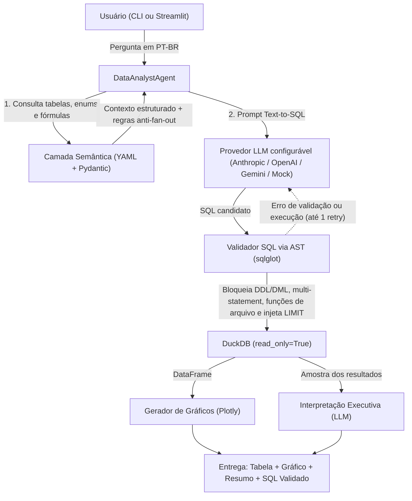

# 📊 Analista de Dados com IA — Text-to-SQL com Camada Semântica

Agente analítico em Python que traduz perguntas de negócio em português para **SQL DuckDB validado**, executa consultas somente leitura contra uma base analítica de seguros e devolve **tabela, gráfico interativo (Plotly) e interpretação executiva curta**.

> **Autor:** Kaique Santos — Analista de Dados Pleno | Sistemas de Informação (USP) · [github.com/kaique321123](https://github.com/kaique321123)
> **Nota de privacidade:** todos os dados deste repositório são **100% sintéticos**, gerados de forma determinística (`seed=42`) sem qualquer vínculo com empresas, clientes ou regras proprietárias.

---

## 🎯 Problema que este projeto resolve

Equipes de negócio frequentemente dependem da fila de BI para responder perguntas ad-hoc (*"Qual a sinistralidade por ramo?"*, *"Qual canal tem maior churn?"*). Por outro lado, conectar um LLM diretamente ao banco de dados traz três riscos clássicos em produção:

1. **Inconsistência semântica:** o modelo pode "inventar" fórmulas diferentes para a mesma métrica (ex.: esquecer de filtrar apólices elegíveis no cálculo de renovação ou duplicar prêmios ao fazer `JOIN` direto com sinistros — *fan-out*).
2. **Risco de segurança:** prompts maliciosos ou alucinações podem gerar comandos destrutivos (`DROP`, `DELETE`, `COPY`, leitura de arquivos locais ou queries sem `LIMIT`).
3. **Falta de mensuração:** sem avaliação objetiva, não se sabe se o agente realmente acerta os números esperados.

Este projeto demonstra uma arquitetura enxuta e auditável para endereçar os três pontos.

---

## 🏗️ Arquitetura



### Decisões de Design
- **Camada semântica declarativa (`semantic_layer/*.yaml`):** inspirada em padrões como *dbt MetricFlow* e *Cube*, centraliza tabelas, valores válidos, relacionamentos e fórmulas SQL oficiais (com `caveats` explícitos, como a regra anti-fan-out da sinistralidade). Validada com **Pydantic** no carregamento.
- **Defesa em profundidade no SQL:** validação por árvore sintática (**AST via `sqlglot`**) em vez de regex frágil, garantindo somente `SELECT`/`WITH`/`UNION`, bloqueando funções DuckDB de acesso a arquivos/sistema (`read_csv_auto`, `duckdb_settings`, `pragma_*`), restringindo tabelas à lista da camada semântica, aplicando `LIMIT` automático e executando em conexão DuckDB `read_only=True`.
- **Auto-correção controlada:** se o SQL falhar na validação ou na execução DuckDB, o erro exato é devolvido ao LLM para 1 tentativa de correção antes de abortar.
- **Provedor LLM desacoplado (`httpx`):** configurável por variável de ambiente (`anthropic`, `openai`, `gemini`), além de um modo `mock` determinístico para testes unitários rápidos e demonstração offline sem custo de API.
- **Avaliação por *Execution Accuracy*:** o runner em `evals/run_eval.py` compara o resultado executado da query gerada com o resultado da query gabarito, em vez de comparar strings SQL literalmente.

---

## 📁 Estrutura do Repositório

```text
analista-ia-seguros/
├── app/
│   └── streamlit_app.py        # Interface web com chat, gráfico, tabela e catálogo semântico
├── data/
│   └── generate_data.py        # Gerador determinístico de dados sintéticos (DuckDB)
├── evals/
│   ├── benchmark.yaml          # 12 perguntas de negócio em PT-BR com SQL gabarito
│   └── run_eval.py             # Medição de SQL Válido (%) e Execution Accuracy (%)
├── semantic_layer/
│   ├── models.yaml             # Tabelas, colunas, enums e relacionamentos
│   └── metrics.yaml            # Métricas oficiais de seguros e regras de negócio
├── src/analista_ia/
│   ├── agent.py                # Orquestrador do fluxo Text-to-SQL + auto-correção
│   ├── charts.py               # Seleção automática de gráficos Plotly
│   ├── cli.py                  # Interface de linha de comando (Rich)
│   ├── config.py               # Configurações via .env (pydantic-settings)
│   ├── db.py                   # Executor DuckDB em modo read_only=True
│   ├── llm.py                  # Clientes REST (Anthropic, OpenAI, Gemini) + Mock
│   ├── semantic.py             # Loader e busca de métricas na camada semântica
│   └── sql_validator.py        # Validação AST (sqlglot) e saneamento de LIMIT
├── tests/                      # 33 testes automatizados (pytest)
├── .env.example
└── pyproject.toml
```

---

## 🚀 Como Rodar

### 1. Clonar e configurar o ambiente
```bash
git clone https://github.com/kaique321123/analista-ia-seguros.git
cd analista-ia-seguros

python -m venv .venv
# Windows (PowerShell):
.\.venv\Scripts\Activate.ps1
# Linux/macOS:
# source .venv/bin/activate

pip install -e ".[dev]"
```

### 2. Gerar a base analítica sintética no DuckDB
```bash
python data/generate_data.py
```
Saída esperada (`seed=42`):
- `clientes`: 2.000 registros
- `apolices`: 4.500 registros (2023–2025, ramos *Auto, Residencial, Vida, Empresarial*)
- `renovacoes`: 2.268 registros
- `sinistros`: 650 registros

### 3. Configurar o provedor de LLM (opcional)
Copie o arquivo de exemplo e preencha apenas a chave do provedor escolhido:
```bash
cp .env.example .env
```
Variáveis suportadas:
- `LLM_PROVIDER`: `anthropic` | `openai` | `gemini` | `mock`
- `LLM_MODEL`: opcional (usa o padrão do provedor se vazio)
- `ANTHROPIC_API_KEY` / `OPENAI_API_KEY` / `GEMINI_API_KEY`

> Sem chave configurada, você já pode testar todo o fluxo imediatamente usando `--provider mock`.

### 4. Usar via CLI
```bash
# Pergunta única (modo mock ou usando o provedor do .env)
analista-ia --provider mock "Qual a sinistralidade por ramo?"

# Salvando o gráfico interativo em HTML
analista-ia --provider mock "Qual a taxa de renovação e churn por canal de venda?" --save-chart outputs/renovacao.html

# Modo interativo
analista-ia
```

### 5. Usar via Streamlit
```bash
streamlit run app/streamlit_app.py
```

---

## 💬 Exemplos de Perguntas e Resultados Reais

### Exemplo 1 — *"Qual a sinistralidade por ramo?"*
- **Métrica acionada na camada semântica:** `Sinistralidade (%)` (com regra *anti-fan-out* agregando sinistros por `apolice_id` em CTE antes do `LEFT JOIN`).
- **Resultado na base sintética (`seed=42`):**

| ramo | premio_emitido_total (R$) | sinistros_pagos_total (R$) | sinistralidade_pct (%) |
|---|---:|---:|---:|
| Empresarial | 3.649.226,63 | 714.842,85 | 19,59 |
| Auto | 6.027.360,99 | 926.940,69 | 15,38 |
| Vida | 1.394.266,60 | 151.192,06 | 10,84 |
| Residencial | 1.155.087,27 | 104.561,78 | 9,05 |

### Exemplo 2 — Outras perguntas suportadas
- *"Qual a taxa de renovação e churn por canal de venda?"*
- *"Quais os principais motivos de não renovação?"*
- *"Qual o ticket médio por ramo e segmento?"*
- *"Qual a evolução mensal do prêmio emitido em 2024 e 2025?"*
- *"Qual a severidade média de sinistros pagos por ramo?"*

---

## 🧪 Testes e Avaliação (Evals)

### Rodar a suíte de testes unitários e de segurança
```bash
pytest
```
Cobre integridade referencial dos dados sintéticos, validação da camada semântica YAML, bloqueio de SQL destrutivo/injeção/funções de arquivo via AST, auto-correção do agente e validação de todas as 12 queries gabarito do benchmark.

### Rodar o benchmark de acurácia Text-to-SQL
```bash
# Avaliando com seu provedor real configurado no .env
python evals/run_eval.py

# Ou validando o pipeline de avaliação no modo mock
python evals/run_eval.py --provider mock
```
O relatório exibe **SQL Válido (%)** e **Execution Accuracy (%)** por categoria (*agregação básica, métrica semântica, anti-fan-out, join, série temporal*).

---

## ⚠️ Limitações Conhecidas e Próximos Passos

- **Escopo de conversa:** cada pergunta é respondida de forma independente (sem memória multi-turno de filtros anteriores). *Próximo passo:* manter contexto de filtros da sessão para follow-ups (*"agora filtre só para 2025"*).
- **Recuperação semântica:** a camada semântica inteira cabe no prompt atual (4 tabelas, 10 métricas). Em data warehouses com centenas de tabelas, o próximo passo seria recuperação via embeddings/RAG filtrando apenas tabelas e métricas relevantes.
- **Controle de acesso (RBAC/RLS):** em produção, a conexão ao warehouse deve aplicar permissões por perfil de usuário (*Row-Level Security*) e auditoria de logs das queries executadas.
- **Observabilidade:** integrar rastreamento de latência, custo por token e feedback do usuário (👍/👎) para retroalimentar o conjunto de `evals/`.
